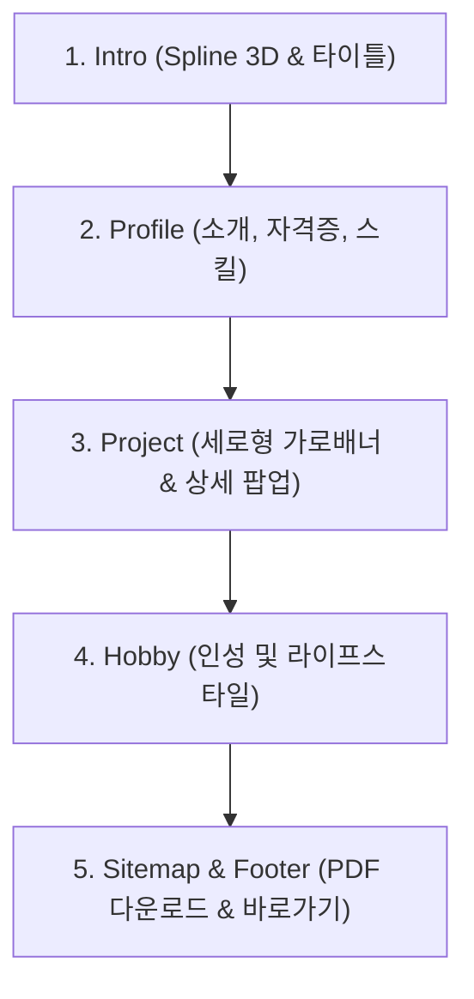

# [PRD] 송새나 취업 포트폴리오 웹사이트 (React & Spline 3D)

---

## 1. 프로젝트 개요 (Project Overview)

### 1.1 프로젝트 명
- **새나의 포트폴리오 (Saena's Portfolio)**
- 부제: 인사담당자의 시선을 사로잡는 신입 사무직 맞춤형 인터랙티브 포트폴리오

### 1.2 기획 배경 및 목적
- **취업 목적 최적화**: 2006년생 신입 사무원으로서 성실함, 꼼꼼함, 실무 OA 및 회계 기초 역량(컴활 2급, Excel 365, FAT 2급)을 직관적으로 어필.
- **차별화된 첫인상**: 기존의 정형화된 이력서 포맷을 탈피하여, 트렌디한 3D 인터랙션(Spline 3D 로봇)과 세련된 UI를 결합해 인사담당자(HR)에게 강렬하고 친근한 첫인상 부여.
- **유지보수 및 확장성**: React(Vite) 기반의 데이터-뷰 분리 설계를 통해 향후 실제 이미지 교체 및 프로젝트 추가/수정이 손쉽게 이루어지도록 구성.

### 1.3 타깃 사용자 (Target Audience)
- **주요 타깃**: 기업 인사담당자(HR), 채용 매니저, 사무/경영지원 부서 팀장
- **사용자 행동 패턴**: 30초~1분 내외의 짧은 열람 시간 동안 핵심 스펙, 직무 적합도, 실무 활용 역량을 빠르게 스캐닝함.

---

## 2. 기술 스택 및 개발 환경 (Tech Stack & Environment)

| 구분 | 선정 기술 / 도구 | 비고 / 선정 사유 |
| :--- | :--- | :--- |
| **Framework / Bundler** | React 18 / 19, Vite | 빠른 빌드 및 HMR, 가벼운 번들 사이즈 |
| **Styling** | Tailwind CSS (또는 Modern CSS Modules) | 깔끔하고 반응형 레이아웃 구축에 최적화 |
| **3D Engine / Embed** | Spline 3D Viewer (iframe) | 경량 3D 인터랙션 제공 (인사하는 로봇) |
| **Icons / UI Components** | Lucide React | 모던하고 일관된 직무/자격증 아이콘 세트 |
| **Asset Delivery** | Public Static Asset Path | `/public/images/projects/`, `/public/resume/` |

---

## 3. 정보 구조 및 화면 구성 (Information Architecture)

웹사이트는 한 눈에 들어오는 **단일 페이지 애플리케이션(SPA)** 형태로, 자연스러운 스크롤 흐름에 따라 아래 순서로 배치됩니다:



---

## 4. 섹션별 상세 기능 요구사항 (Detailed Requirements)

### 4.1 Intro 섹션 (인트로)
- **주요 목적**: 호기심을 유발하고 친근한 인상을 주는 인터랙티브 히어로(Hero) 영역.
- **디자인 가이드**:
  - 기존 시안 상단의 검색/텍스트 `input` 필드는 **완전 제거**.
  - 화면 중앙에 감성적인 폰트와 포인트 컬러로 **‘새나의 포트폴리오’** 타이틀 배치.
  - 서브 타이틀: *"성실함과 꼼꼼함으로 조직의 든든한 서포터가 될 신입 사무원 송새나입니다."*
- **Spline 3D iframe 임베드**:
  ```html
  <iframe 
    src='https://my.spline.design/genkubgreetingrobot-O6HYTNc45XsxAe6oNwD2GBwO/' 
    frameborder='0' 
    width='100%' 
    height='100%'
    title='Greeting Robot 3D'
  ></iframe>
  ```
  - 반응형 컨테이너(Aspect Ratio 유지) 적용 및 백그라운드 자연스러운 블렌딩 처리.

---

### 4.2 Profile 섹션 (프로필)
인사담당자가 가장 중점적으로 확인하는 핵심 역량 요약 섹션입니다. 3개의 카드/블록으로 구성합니다.

#### (1) 기본 정보 & 내 소개 (About Me)
- **이름**: 송새나
- **생년월일**: 2006년 4월 7일
- **희망 직무**: 사무직 (일반사무 / 사무행정 / 경영지원)
- **소개글**:
  - 기본에 충실하고 꼼꼼한 문서 정리 능력과 원활한 소통 능력을 갖춘 인재상 강조.
  - "신속하고 정확한 업무 처리로 팀의 효율을 극대화하겠습니다."

#### (2) 취득 자격증 (Certificates)
신뢰감을 줄 수 있도록 발급 기관 및 취득 연월(플레이스홀더)을 명시한 뱃지/카드 형태:
1. **컴퓨터활용능력 2급** (대한상공회의소) - 스프레드시트 활용 및 비즈니스 데이터 처리 능력 입증
2. **Excel 365 Associate** (Microsoft) - MS 공식 인증을 통한 고급 엑셀 실무 역량 입증
3. **FAT 2급 (회계정보처리 2급)** (한국공인회계사회) - 더존 SmartA 기반 전산회계 및 전표 처리 기초 역량 입증

#### (3) 보유 기술 (Skills)
직무 관련 숙련도 및 실무 수행 가능 범위를 직관적으로 표시:
- **MS Excel**: 함수(VLOOKUP, IF, SUMIFS 등), 피벗 테이블, 조건부 서식, 대량 데이터 정리 및 차트 시각화
- **MS PowerPoint**: 가독성 높은 기획서 및 보고서 작성, 템플릿 마스터 활용, 발표 자료 구성
- **MS Word**: 규격에 맞춘 공문서 작성, 기안서/매뉴얼 문서화, 빠른 타이핑 및 오탈자 검수

---

### 4.3 Project 섹션 (프로젝트)
- **레이아웃**: **가로 배너형 카드들을 세로로 나열 (Vertical Stack)**.
- **동적 렌더링 (Dynamic Component)**:
  - 하드코딩이 아닌 `projectsData.js` 배열의 길이에 따라 카드가 자동으로 늘어나거나 줄어들도록 구현 (`Array.map()`).
- **가로 배너 카드 구성 (좌/우 분할)**:
  - **좌측 (미리보기 이미지 영역)**:
    - 외부 임의 이미지를 넣지 않고, 규격화된 **플레이스홀더(Placeholder)** 박스 UI 적용.
    - 사용자가 나중에 실제 이미지로 교체할 수 있도록 박스 중앙에 **타깃 파일명 라벨 오버레이 표기** (예: `📁 public/images/projects/project-1.png`).
  - **우측 (텍스트 정보 영역)**:
    - 프로젝트 제목 (예: "OA 도구를 활용한 사내 비품 관리 및 결산 보고서 자동화")
    - 진행 기간 및 수행 역할
    - 핵심 요약 (2~3줄)
    - 사용 스킬 태그 (예: `#Excel`, `#피벗테이블`, `#FAT회계기초`)
    - [상세보기 →] 버튼
- **인터랙션 (상세 팝업 모달 - Modal Popup)**:
  - 배너 카드 클릭 시 부드러운 애니메이션과 함께 상세 팝업 오픈.
  - 팝업 내용: 프로젝트 배경 및 목적, 주요 수행 단계, 문제 해결 경험, 실무 적용 기대 효과, 상세 이미지 플레이스홀더.
  - `ESC` 키 또는 배경 오버레이 클릭 시 닫기 지원.
- **로딩 상태 (Skeleton UI)**:
  - 프로젝트 데이터 또는 이미지 로딩 중 화면이 덜컹거리지 않도록 은은한 펄스(Pulse) 애니메이션이 적용된 가로형 스켈레톤 카드 제공.
- **이미지 폴더 구조화**:
  - 프로젝트 루트에 `public/images/projects/` 디렉터리를 사전 생성하여 파일만 넣으면 즉시 연동되도록 설계.

---

### 4.4 Hobby 섹션 (취미/특기)
- **주요 목적**: 단순 나열이 아닌, 사무직 업무 태도(집중력, 성실함, 꼼꼼함, 스트레스 관리)와 연결되는 친근한 인성적 매력 어필.
- **추천 구성 (사무직 연계 취미 3종)**:
  1. **다이어리 & 불렛저널 작성**: 일정 관리 및 하루 루틴 체계화 (꼼꼼한 업무 계획 수립 역량)
  2. **디지털 캘리그래피 & 타이핑**: 텍스트 검수와 집중력 유지, 문서 레이아웃 감각
  3. **러닝 / 가벼운 산책**: 꾸준한 체력 관리 및 긍정적인 마인드 유지

---

### 4.5 Sitemap & Footer 섹션 (사이트맵 & 다운로드)
- **최하단 배치**:
  - **[이력서 PDF 다운로드] CTA 버튼**:
    - 인사담당자가 가장 편리하게 이력서를 소장할 수 있도록 크고 눈에 띄는 버튼 배치.
    - `📁 public/resume/송새나_이력서.pdf` 파일과 자동 다운로드(`download` 속성) 트리거 연동.
  - **사이트맵(Sitemap) 네비게이션**:
    - `Intro`, `Profile`, `Project`, `Hobby` 섹션으로 부드럽게 이동하는 스무스 스크롤 앵커 링크 제공.
  - **Contact & Footer 정보**:
    - 이메일, 연락처(플레이스홀더), 위치 정보(지역), 저작권 문구 (`© 2026 Song Sae-na. All Rights Reserved.`).

---

## 5. 프로젝트 디렉터리 구조 설계 (Architecture Plan)

사용자가 추후 이미지와 문서를 쉽게 교체할 수 있도록 명확히 분리된 구조:

```text
새 폴더/
├── public/
│   ├── images/
│   │   ├── projects/          <-- [필독] 프로젝트 실제 이미지를 넣을 폴더
│   │   │   ├── project-1.png  (권장: 800x450 가로 비율)
│   │   │   ├── project-2.png
│   │   │   └── project-3.png
│   │   └── profile/           <-- 프로필 사진용 폴더 (profile.jpg)
│   └── resume/
│       └── 송새나_이력서.pdf   <-- [필독] 실제 이력서 PDF 파일을 넣을 폴더
├── src/
│   ├── assets/                <-- 전역 정적 자원 (로고, 기본 아이콘)
│   ├── components/
│   │   ├── intro/
│   │   │   └── IntroSection.jsx      (Spline 3D 로봇 & 메인 타이틀)
│   │   ├── profile/
│   │   │   ├── ProfileSection.jsx    (내 소개, 자격증, 스킬)
│   │   │   ├── CertificateBadge.jsx
│   │   │   └── SkillBar.jsx
│   │   ├── project/
│   │   │   ├── ProjectSection.jsx    (프로젝트 세로 목록 리스트)
│   │   │   ├── ProjectCard.jsx       (가로형 배너 카드)
│   │   │   ├── ProjectModal.jsx      (상세 팝업 모달)
│   │   │   └── ProjectSkeleton.jsx   (로딩 스켈레톤 UI)
│   │   ├── hobby/
│   │   │   └── HobbySection.jsx      (취미 & 인성 카드)
│   │   └── sitemap/
│   │       └── FooterSitemap.jsx     (PDF 다운로드 & 사이트맵)
│   ├── data/
│   │   └── portfolioData.js          (프로젝트/스펙/소개 텍스트 통합 관리)
│   ├── App.jsx
│   ├── index.css
│   └── main.jsx
├── index.html
├── package.json
└── vite.config.js
```

---

## 6. 데이터 스키마 명세 (Data Schema: `portfolioData.js`)

프로젝트는 데이터 기반으로 동작하여, 개수 변화에 유연하게 대응합니다:

```javascript
export const projectsData = [
  {
    id: 1,
    title: "ERP & 전산회계(FAT) 기반 전표 전산화 및 결산 보조 프로젝트",
    period: "2024.03 - 2024.04 (4주)",
    role: "회계 전표 입력 및 전산 데이터 검증",
    summary: "기존 수기/엑셀 영수증 데이터를 FAT 2급 기준에 맞추어 표준 계정과목으로 분류하고 오류율 0%를 달성한 전산화 모의 프로젝트입니다.",
    tags: ["FAT 2급", "Excel", "전산회계", "데이터 검증"],
    imageFileName: "project-1.png",
    details: {
      overview: "모의 사업장 데이터를 바탕으로 매입매출 전표 입력부터 결산 보고서 산출까지의 흐름을 체계화했습니다.",
      tasks: [
        "일일 증빙자료 검토 및 적격증빙 분개 처리",
        "더존 SmartA 전표 입력 및 부가세 신고 기초 자료 작성",
        "월별 손익계산서 요약 보고서 작성"
      ],
      result: "수기 대비 처리 속도 40% 향상 및 분개 오류 제로화 달성"
    }
  },
  {
    id: 2,
    title: "Excel 365 함수 기반 사내 비품 및 근태 관리 자동화 시트 구축",
    period: "2024.05 - 2024.05 (3주)",
    role: "템플릿 기획 및 고급 함수 수식 설계",
    summary: "반복적인 비품 재고 조사 및 입출고 관리를 VLOOKUP, INDEX/MATCH, 조건부 서식을 결합하여 자동화한 업무 개선 프로젝트입니다.",
    tags: ["컴활 2급", "Excel 365 Associate", "자동화 서식", "피벗테이블"],
    imageFileName: "project-2.png",
    details: {
      overview: "단순 반복 입력 작업을 최소화하고 실시간 재고 현황을 시각화할 수 있는 통합 대시보드를 구축했습니다.",
      tasks: [
        "비품 품목별 자동 코드 부여 및 유효성 검사 적용",
        "재고 부족 시 경고 알림 조건부 서식 구현",
        "월간 비품 소모 트렌드 피벗 차트 시각화"
      ],
      result: "재고 확인 시간 주당 3시간 -> 15분으로 대폭 단축"
    }
  },
  {
    id: 3,
    title: "MS Word & PowerPoint를 활용한 표준 사무 업무 매뉴얼 및 교육자료 제작",
    period: "2024.06 - 2024.06 (2주)",
    role: "문서 표준 양식 기획 및 레이아웃 디자인",
    summary: "신입 사무원의 빠른 업무 적응을 돕기 위해 공문서 작성 규칙과 보고서 템플릿을 표준화하고 시각화된 매뉴얼을 제작했습니다.",
    tags: ["MS Word", "PowerPoint", "사무행정", "문서표준화"],
    imageFileName: "project-3.png",
    details: {
      overview: "가독성이 떨어지는 기존 지침을 인포그래픽과 일목요연한 체크리스트 형태로 재구성했습니다.",
      tasks: [
        "행정안전부 공문서 규격에 맞춘 워드 기본 서식(스타일) 세팅",
        "핵심 업무 프로세스를 4단계 플로우차트로 시각화 (PPT)",
        "자주 묻는 질문(FAQ) 및 오류 방지 체크리스트 10종 제작"
      ],
      result: "사무 서식 일관성 확보 및 사내 가독성 피드백 95% 만족 달성"
    }
  }
];
```

---

## 7. 비기능적 요구사항 및 UI/UX 원칙 (Non-Functional Requirements)

1. **인사담당자 맞춤형 가독성**:
   - 텍스트 대비(Contrast)를 확실히 하여 인쇄 또는 작은 노트북 모니터에서도 또렷하게 읽힐 것.
   - 여백(Whitespace)을 넉넉히 주어 답답하지 않고 단정한 인상을 부여.
2. **반응형 웹 (Responsive Design)**:
   - 모바일, 태블릿, 데스크톱(1920x1080 등) 모든 해상도에서 레이아웃 붕괴 없이 완벽 지원.
3. **플레이스홀더 및 이미지 대체 용이성**:
   - 이미지가 없더라도 UI가 깨지거나 비어 보이지 않는 세련된 회색조/아이콘 플레이스홀더 제공.
   - 파일명 가이드(예: `[대체 권장: project-1.png]`)가 시각적으로 표시되어 사용자가 폴더에 파일만 넣으면 손쉽게 매칭.
4. **성능 최적화**:
   - Spline iframe은 `loading="lazy"` 속성을 부여하거나 로딩 전 백그라운드 색상을 깔아 레이아웃 시프트(CLS) 방지.
   - 프로젝트 팝업은 포털(Portal) 또는 모달 오버레이로 렌더링하여 부드러운 스크롤 잠금 지원.

---

## 8. 단계별 개발 로드맵 (Milestones)

- **Step 1: 환경 구성 및 기본 뼈대 생성**
  - Vite + React 프로젝트 초기화
  - `public/images/projects/`, `public/images/profile/`, `public/resume/` 디렉터리 생성 및 더미 에셋 준비
- **Step 2: 데이터 모듈 및 인트로/프로필 구현**
  - `portfolioData.js` 작성
  - Spline 3D 로봇 iframe 및 타이틀을 포함한 `Intro` 섹션 구현
  - 내 소개, 3대 자격증 뱃지, 실무 스킬을 담은 `Profile` 섹션 완성
- **Step 3: 프로젝트 배너 및 모달/스켈레톤 구현**
  - 가로형 배너 세로 리스트 구현 (동적 렌더링)
  - 파일명 표기형 이미지 플레이스홀더 컴포넌트 개발
  - 상세 팝업 모달(Modal) 및 스켈레톤 로딩(Skeleton UI) 추가
- **Step 4: 취미, 사이트맵 & PDF 다운로드 연동**
  - 사무직 친화적 `Hobby` 섹션 제작
  - 최하단 `Sitemap` 앵커 링크 및 이력서 PDF 다운로드 버튼 제작
- **Step 5: 크로스 브라우징 및 검수**
  - 모바일/태블릿 반응형 레이아웃 확인
  - 스무스 스크롤 및 최종 코드 정리
